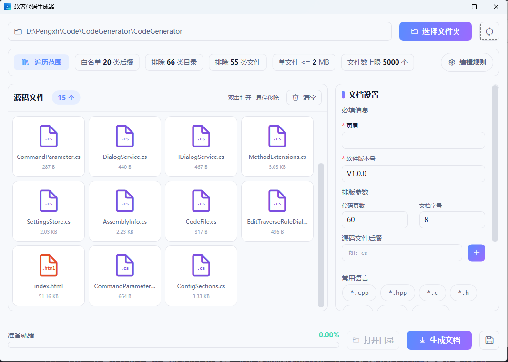
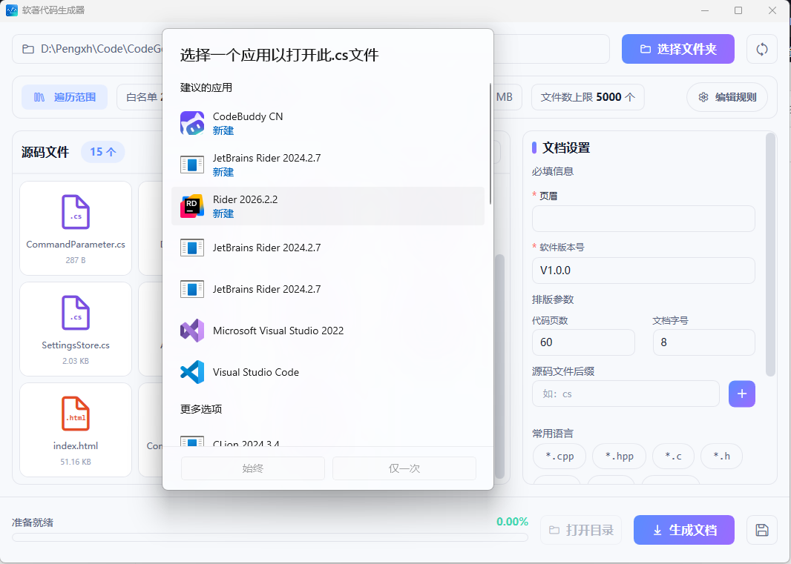

# CodeGenerator

软著代码生成器。

这是一个可以自动生成符合软件著作权申请要求的源代码文档的工具，支持一键扫描项目源码，按规则过滤后生成带页眉页码的 Word
文档和纯文本文件。

## 下载地址

[CodeGenerator.zip](Example/CodeGenerator.zip)

## 功能特性

- **源码扫描**：递归遍历指定文件夹，自动过滤黑名单目录/文件（编译产物、IDE 配置、第三方包等）、隐藏文件、符号链接，并可限制遍历深度、单文件大小和文件总数
- **后缀白名单**：内置 20 种常见代码文件后缀，支持自定义添加，自定义后缀会自动持久化
- **文档生成**：按每页 50 行排版，代码超过一页总数时自动取前一半页数和后一半页数的代码行；生成的 Word
  文档带自定义页眉（软著名称 + 软件版本号）和自动页码
- **灵活配置**：遍历规则、源码目录、自定义后缀、文档保存路径均可通过界面编辑并自动保存，下次启动自动恢复

## 使用方法

### 1. 选择源码文件夹

下载后解压并双击运行，点击【选择文件夹】选择需要格式化的代码源文件夹（尽量不要包含 `build`、`bin`、`obj`
等编译目录，软件已内置常见黑名单规则自动跳过）。

扫描完成后文件列表会按后缀类型着色显示。如果需要调整过滤规则，点击【编辑规则】可以配置黑名单文件夹、黑名单文件、是否跳过隐藏文件/符号链接、单文件大小上限、遍历深度和最大文件数。



### 2. 添加文件后缀

软件内置了 `c/cpp/h/hpp/cs/kt/java/swift/rs/vb/py/js/ts/go/vue/html/php/rb/sh/m` 等常见代码后缀，也可以在输入框中输入自定义后缀（如
`gradle`、`proto`）点击添加，多种后缀可同时生效。

### 3. 查看文件

双击列表中的文件，会使用系统默认程序打开该文件。



### 4. 设置文档参数

在【文档设置】区域填写：

- **页眉内容**：软著登记名称（必填），生成后会与版本号一起显示在每页页眉
- **软件版本号**：默认 `V1.0.0`（必填）
- **代码页数**：默认 60 页。代码总行数超过 `页数 × 50` 行时，自动取前一半页数和后一半页数的有效代码行（如默认 60 页即取前
  1500 行 + 后 1500 行）
- **文档字号**：默认 8，正文代码使用 Consolas 等宽字体

### 5. 生成文档

点击【生成文档】，会在设置的保存路径下生成两份文件：

- `软著代码.docx`：带页眉（软著名称 + 版本号）、自动页码的 Word 文档
- `软著代码.txt`：同内容的纯文本文件

默认保存到软件工作目录，可通过保存路径设置自定义位置（会自动记住）。生成完成后可点击【打开目录】直接定位到输出文件夹。

> 💡 如果生成失败（如无写入权限），会弹出具体错误提示，修改保存路径后重新生成即可。

## 开发环境

项目基于 .NET 8 WPF（MVVM，使用 CommunityToolkit.Mvvm），仅支持 Windows。

构建前请安装 [.NET 8 SDK](https://dotnet.microsoft.com/download/dotnet/8.0)，在仓库根目录运行：

```shell
dotnet build CodeGenerator.sln
```

## 项目结构

```
CodeGenerator/
├── CodeGenerator/            # WPF 主工程
│   ├── Cache/                # 配置持久化（app-config.json）
│   ├── Converters/           # XAML 值转换器
│   ├── Dialog/               # 遍历规则编辑对话框
│   ├── Models/               # 数据模型（CodeFile 等）
│   ├── Utils/                # 工具类（配置存储、对话框服务、扩展方法）
│   ├── ViewModels/           # MVVM 视图模型
│   ├── MainWindow.xaml       # 主界面
│   └── App.xaml              # 应用入口
├── Example/                  # 示例截图与下载包
└── CodeGenerator.sln         # 解决方案
```

## 许可证

[MIT License](LICENSE)
